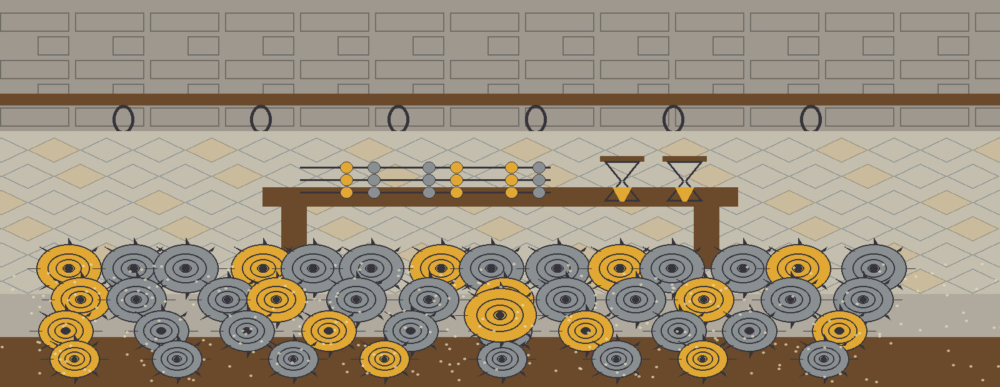
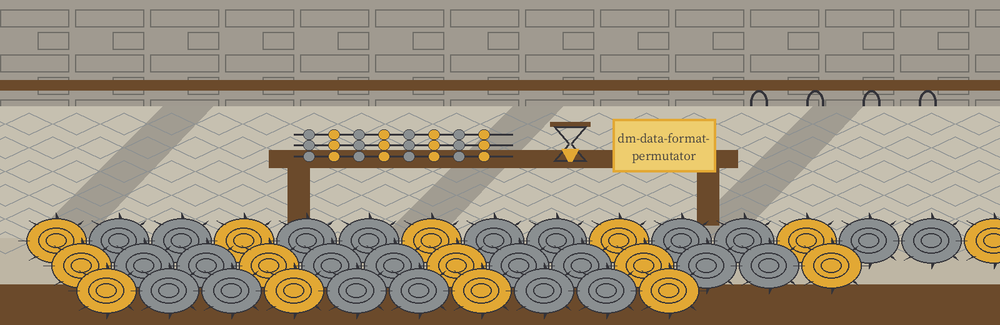
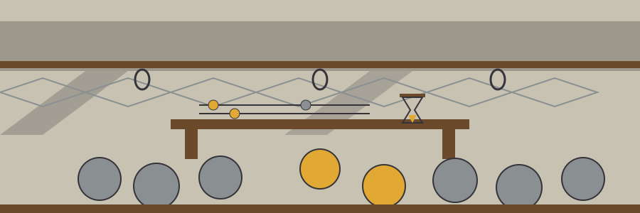

# dm-data-format-permutator

Chronicle entry, in the season of the shell heaps: the name above is set in Cactus Classical Serif in viking oak, as a chronicle entry with a seasonal marker, with a small seal picture at the left of the title block and the shell heap in miniature beside this first heading only.

# dm-data-format-permutator
Randomly permutes the format of data within a column while preserving its inherent characteristics (e.g., date formats, currency formats, telephone number formats). Takes a CSV file and a column name as input. - Focused on Tools designed to generate or mask sensitive data with realistic-looking but meaningless values

## Install
`git clone https://github.com/ShadowGuard-AI/dm-data-format-permutator`

> Wax tablet: the README install line names an older organisation.

## Usage
`python3 main.py csv_file column_name [options]`

## Parameters
- `-h`: Show help message and exit
- `csv_file`: The CSV file to process (positional).
- `column_name`: The name of the column to permute (positional).
- `-o`: The output CSV file (default: <input_file>_masked.csv).
- `-l`: Faker locale (e.g., en_US, fr_FR). Defaults to en_US.

> Wax tablet: input is validated before any output opens.

## Behavior notes
- The input is read and validated before the output file is opened. A run that fails, for example a missing column, an empty input, or an undecodable input, creates no output file.
- The output file may not be the input file. If the resolved output path is the input file, by the same spelling or through a symlink, the run refuses at exit 1 before any file is opened and the input is left untouched.
- The run counts the cells it actually replaces in the named column. If no cell was replaced, for example a column of dates that do not parse, the run prints "No values were permuted.", exits 1, and writes no output file.

> Wax tablet: the output may not resolve to the input.

> Wax tablet: a run that replaces no cell exits 1 and writes nothing. It prints "No values were permuted."

## License
This project is released under the MIT License. See the [LICENSE](LICENSE) file for details.

## Tablets gathered at the yard

The main button of this re-skin reads Permute the Column. Its locale field label reads Faker Locale. Its guard heading reads The Output Is Never the Input. Its count heading reads A Run That Replaces Nothing Fails. It ends in lamplight indoors: heap tallied, tablet smoothed and shelved, bench swept, and the yard outside standing dark.
